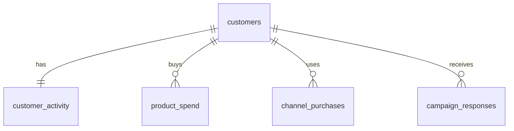

# Marketing Campaign Analysis in MySQL

SQL analysis of 2,240 customers of a retailer selling wine, meat, fish, fruit, sweets and gold products: who they are, what they buy, which channels and campaigns work, and which customers are most valuable.

**Dialect:** MySQL 8.0 | **Tools:** MySQL Server, MySQL Workbench | **Data:** [Maven Analytics, Marketing Campaign Results](https://mavenanalytics.io/data-playground/marketing-campaign-results) (public domain)

---

## Dataset

One wide CSV with one row per customer: demographics, spend by product category (last 2 years), purchases by channel, website visits, recency, and whether the customer accepted each of 6 marketing campaigns. See [data/marketing_data_dictionary.csv](data/marketing_data_dictionary.csv).

Because the source is a single table, I split it into a small relational model so the analysis uses real joins:



A view, `customer_summary`, joins everything back to one row per customer for analysis.

## Business questions

1. What does the average customer look like, and which groups spend the most?
2. Which products perform best?
3. Which channels underperform, and what is related to web purchases?
4. Which campaign was most successful, and who responds?
5. Who are the most valuable customers, and how concentrated is spend?
6. Are there nulls or outliers, and how should they be handled?

## Key findings

All numbers come from the scripts in `sql/`; the full output is in [results/query_outputs.txt](results/query_outputs.txt).

**Customers and spend**
- The average customer is 45 years old, has an income of about 52,000, has roughly one child or teenager at home, spent about 606 over two years, and made 12.5 purchases.
- Household type matters most: customers with no children spend about 1,106 on average, versus 186 for households with only young children (about 6x).
- Spend rises sharply with income: the top income quartile spends about 1,360 on average versus 82 in the bottom quartile.
- Spend is concentrated: the top 20% of customers account for 52% of all spend, and the top 40% for 82%.

**Products and channels**
- Wine (50%) and meat (28%) make up 78% of all spend. Wine is the top category in every country.
- Stores carry 46% of purchases, the website 33%, and catalogs 21%. Catalog use grows with income (9% of purchases in the lowest income quartile, 30% in the highest), while the web share is highest in the lower-middle quartiles.
- Website visits do **not** predict web purchases (correlation -0.06). The heaviest visitors (9+ visits last month) are among the lowest spenders (average 267 vs 1,205 for 0-2 visits). Web purchases are more strongly related to total spend (0.52), income (0.46), and fewer children at home (-0.36).

**Campaigns**
- The last campaign had a 14.9% acceptance rate, about double campaigns 1, 3, 4 and 5 (6.4% to 7.5%). Campaign 2 was the weakest at 1.3%.
- Past behavior is a strong signal: 8% of customers with no earlier acceptance accepted the last campaign, versus 31% of those who accepted one earlier campaign and 51% of those who accepted two.
- Recent customers respond more: 26.5% of customers who bought in the last 24 days accepted, versus 7.4% of those who last bought 75 to 99 days ago.
- Responders spend more (987 vs 539), earn more (60,210 vs 50,512 on average), and have fewer children at home.
- India has the lowest last-campaign response rate (8.8% vs 16.1% in Spain) and the lowest average spend.

**Segments (RFM)**
- "Champions" (recent, frequent, high spend) are 24% of customers and 43% of spend, with a 27% response rate.
- "At-risk high value" customers (high spend but not recent) are 25% of customers and 45% of spend, with only a 15% response rate.

## Featured queries

### Do earlier campaign acceptances predict the next one? ([06_campaign_performance.sql](sql/06_campaign_performance.sql))

```sql
SELECT
    previous_campaigns_accepted                 AS earlier_campaigns_accepted,
    COUNT(*)                                    AS customers,
    ROUND(AVG(total_spend), 0)                  AS avg_total_spend,
    ROUND(100 * AVG(accepted_last_campaign), 1) AS last_campaign_response_pct
FROM customer_summary
GROUP BY previous_campaigns_accepted
ORDER BY previous_campaigns_accepted;
```

| earlier_campaigns_accepted | customers | avg_total_spend | last_campaign_response_pct |
|---|---|---|---|
| 0 | 1777 | 478 | 8.2 |
| 1 | 325 | 922 | 31.1 |
| 2 | 83 | 1408 | 50.6 |
| 3 | 44 | 1706 | 79.5 |
| 4 | 11 | 1502 | 90.9 |

The groups with 3 or 4 earlier acceptances are small, so treat their rates as indicative.

### RFM segmentation ([07_customer_segmentation.sql](sql/07_customer_segmentation.sql))

```sql
WITH scored AS (
    SELECT
        customer_id,
        total_spend,
        accepted_last_campaign,
        NTILE(4) OVER (ORDER BY recency_days DESC) AS r_score,
        NTILE(4) OVER (ORDER BY total_purchases)   AS f_score,
        NTILE(4) OVER (ORDER BY total_spend)       AS m_score
    FROM customer_summary
),
segmented AS (
    SELECT
        *,
        CASE
            WHEN r_score >= 3 AND f_score >= 3 AND m_score >= 3 THEN '1 Champions'
            WHEN r_score <= 2 AND f_score >= 3 AND m_score >= 3 THEN '2 At-risk high value'
            WHEN r_score >= 3 AND m_score <= 2                  THEN '3 Recent, low spend'
            WHEN r_score <= 2 AND m_score <= 2                  THEN '4 Low engagement'
            ELSE '5 Core'
        END AS segment
    FROM scored
)
SELECT
    segment,
    COUNT(*)                                    AS customers,
    ROUND(AVG(total_spend), 0)                  AS avg_total_spend,
    ROUND(100 * SUM(total_spend) / SUM(SUM(total_spend)) OVER (), 1) AS pct_of_total_spend,
    ROUND(100 * AVG(accepted_last_campaign), 1) AS last_campaign_response_pct
FROM segmented
GROUP BY segment
ORDER BY segment;
```

| segment | customers | avg_total_spend | pct_of_total_spend | last_campaign_response_pct |
|---|---|---|---|---|
| 1 Champions | 533 | 1095 | 43.0 | 27.2 |
| 2 At-risk high value | 549 | 1109 | 44.9 | 14.6 |
| 3 Recent, low spend | 573 | 111 | 4.7 | 13.8 |
| 4 Low engagement | 547 | 113 | 4.5 | 3.8 |
| 5 Core | 38 | 1035 | 2.9 | 23.7 |

## Recommendations

1. **Target campaigns at recent customers and past responders.** Both groups respond at several times the average rate.
2. **Re-engage the "at-risk high value" segment.** They hold 45% of spend but respond at roughly half the rate of Champions.
3. **Review what went wrong with Campaign 2** (1.3% acceptance). The data does not say how the campaigns differed, so this needs the campaign details.
4. **Look at the website experience.** Frequent visitors are not buying more on the site. Testing whether lower-income, high-visit customers respond to web-specific offers is a reasonable next step.
5. **Use wine and meat as the anchor for cross-selling**, since they drive almost four-fifths of spend.
6. **Investigate India** (lowest response and spend) before spending more there.

## Data quality notes

Found in [02_data_quality_checks.sql](sql/02_data_quality_checks.sql) and handled in [03_build_clean_tables.sql](sql/03_build_clean_tables.sql):

| Issue | Count | Decision |
|---|---|---|
| Missing income | 24 | Kept as NULL, not imputed; excluded from income analysis only |
| Income of 666,666 (next highest is 162,397) | 1 | Treated as an error and set to NULL |
| Birth years before 1930 (1893, 1899, 1900) | 3 | Set to NULL |
| Marital status "Alone" | 3 | Mapped to "Single" |
| Marital status "YOLO" or "Absurd" | 4 | Mapped to "Unknown" |
| Customers with no purchases in any channel | 6 | Kept; excluded from purchase-share ratios |
| Customers with more discount purchases than total purchases | 3 | Discount purchases treated as a separate count |
| Country with only 3 customers (Mexico) | 3 | Excluded from country comparisons (100+ customer minimum) |

## Limitations

- The data does not say which customers were targeted by each campaign, so acceptance rate is accepted / all customers.
- There are no purchase dates, so trends over time cannot be analysed; spend covers a 2-year window, and the currency is not stated.
- Correlations show association, not cause.
- `NTILE` splits tied values arbitrarily, so RFM scores near ties can shift slightly between runs.
- The source page lists 499 records, but the file has 2,240 customers.

## How to reproduce

1. Install MySQL 8.0 or later.
2. Edit the file path in `sql/00_create_schema_and_load.sql` (see [data/README.md](data/README.md)).
3. Run the scripts in order:

| File | Purpose |
|---|---|
| `sql/00_create_schema_and_load.sql` | Creates the `marketing` database and loads the CSV into a raw table |
| `sql/01_data_exploration.sql` | Size, categories, ranges |
| `sql/02_data_quality_checks.sql` | Nulls, outliers, odd values, and the cleaning decisions |
| `sql/03_build_clean_tables.sql` | Builds the clean, normalized tables and the `customer_summary` view |
| `sql/04_customer_profile.sql` | Average customer, education, country, age, income, household type |
| `sql/05_products_and_channels.sql` | Product ranking, channel mix, web visits, correlations |
| `sql/06_campaign_performance.sql` | Campaign success and responder profile |
| `sql/07_customer_segmentation.sql` | RFM segments and spend concentration |

## Skills demonstrated

Schema design and normalization (wide table to relational model), bulk loading with `LOAD DATA`, data cleaning, views, CTEs, window functions (`RANK`, `NTILE`, `PERCENT_RANK`, partitioned windows, share-of-total), conditional aggregation, `CASE` bucketing, and a hand-built Pearson correlation.
